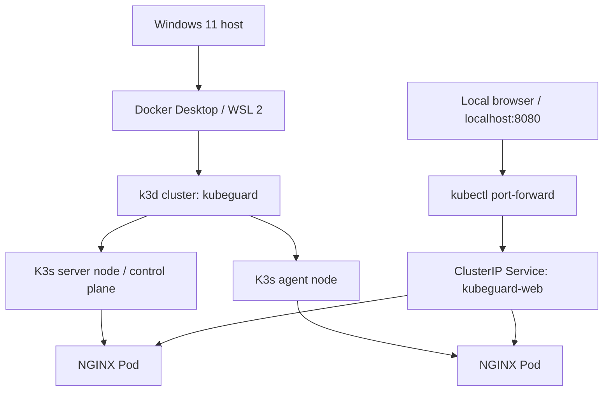
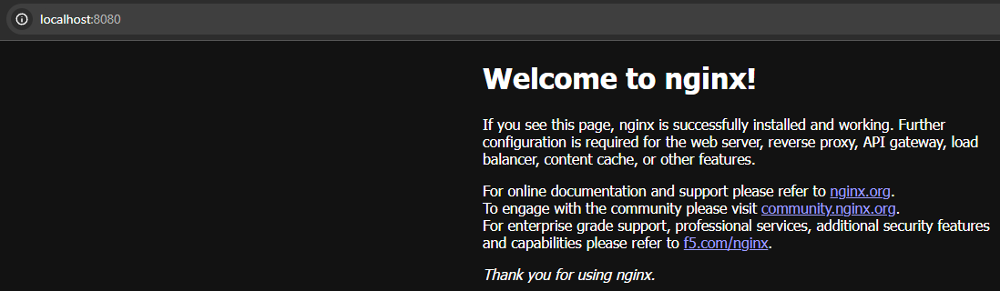

# KubeGuard — Kubernetes DevSecOps Platform

> A hands-on Kubernetes lab evolving into a secure, automated and observable DevSecOps platform.

**Project status:** Phase 1 completed — local Kubernetes cluster and sample workload validated. Security and CI/CD integrations described below are **planned**, not yet implemented.

## Overview

KubeGuard is a portfolio project focused on learning and demonstrating the operational practices required to deploy, manage, monitor and secure containerized applications in Kubernetes.

The project begins with a reproducible local K3s cluster managed through k3d and will evolve through infrastructure-as-code, automated delivery, GitOps, observability and runtime security.

## Current architecture



> This is a local learning environment, **not** a highly available production cluster. A single control-plane server remains a single point of failure. Kubernetes scheduling placed the two initial Pods on different nodes, but the current manifests do not enforce anti-affinity.

## Technology stack

| Area | Technology | Status |
| --- | --- | --- |
| Container runtime | Docker Desktop / WSL 2 | Implemented |
| Kubernetes distribution | K3s v1.35.5 via k3d v5.9.0 | Implemented |
| Cluster operations | kubectl | Implemented |
| Sample workload | NGINX (2 replicas) | Implemented |
| Kubernetes resources | Namespace, Deployment, ClusterIP Service, readiness probe, resource requests/limits | Implemented |
| CI/CD and image scanning | GitHub Actions, Trivy | Implemented |
| GitOps and packaging | Argo CD, Helm | Planned |
| Kubernetes policy | RBAC, NetworkPolicy, Kyverno | Planned |
| Observability | Prometheus, Grafana | Planned |
| Runtime threat detection | Falco | Planned |

## Prerequisites

- Windows with Docker Desktop configured to run Linux containers (WSL 2 backend)
- `k3d` and `kubectl` installed and available in `PATH`
- A terminal with access to Docker Desktop

## Reproduce Phase 1

Clone this repository and run the following commands from its root directory. The cluster name `kubeguard` must be available; if it already exists, reuse it rather than creating a duplicate.

```powershell
k3d cluster create kubeguard --servers 1 --agents 1 --wait --timeout 180s
kubectl config use-context k3d-kubeguard
kubectl get nodes -o wide
kubectl create namespace kubeguard
kubectl apply -f k8s/base/web.yaml
kubectl rollout status deployment/kubeguard-web -n kubeguard --timeout=120s
kubectl get pods,deployments,services -n kubeguard -o wide
```

In a terminal, expose the internal Service to your local machine:

```powershell
kubectl port-forward -n kubeguard svc/kubeguard-web 8080:80
```

Open **http://localhost:8080** and confirm that the NGINX welcome page appears. The port-forward runs until you stop the command (Ctrl+C).

> If the namespace already exists, skip `kubectl create namespace kubeguard`.

## Phase 1 validation

- [x] Docker Desktop and WSL 2 verified
- [x] k3d and kubectl installed
- [x] Two-node K3s cluster created (one server, one agent)
- [x] Kubernetes system Pods verified healthy
- [x] `kubeguard` namespace created
- [x] Two NGINX replicas running and Deployment available
- [x] ClusterIP Service configured
- [x] Application accessed through `kubectl port-forward`
- [x] CLI evidence and browser screenshot captured

### Evidence

| Evidence | File |
| --- | --- |
| Cluster nodes | [`nodes.txt`](evidence/phase-01/nodes.txt) |
| System Pods | [`system-pods.txt`](evidence/phase-01/system-pods.txt) |
| Application resources | [`application.txt`](evidence/phase-01/application.txt) |



> Evidence captures represent a point-in-time validation of the lab, not ongoing production monitoring.

## Roadmap

- [x] **Phase 1 — Cluster foundation:** provision Kubernetes, deploy NGINX, capture evidence
- [ ] **Phase 2 — Custom application:** develop and containerize a small Python API; Kubernetes manifests and health endpoints
- [ ] **Phase 3 — CI pipeline:** automated tests, image builds, Trivy vulnerability scanning
- [ ] **Phase 4 — GitOps:** Helm charts and Argo CD deployment workflow
- [ ] **Phase 5 — Security controls:** least-privilege RBAC, NetworkPolicies, Kyverno policies
- [ ] **Phase 6 — Observability:** Prometheus metrics and Grafana dashboards
- [ ] **Phase 7 — Threat detection:** controlled Falco detections and documented investigation scenarios
- [ ] **Phase 8 — Portfolio release:** architecture documentation, threat model, demonstrations and lessons learned

## Repository structure

```text
KubeGuard/
├── k8s/
│   └── base/
│       └── web.yaml
├── evidence/
│   └── phase-01/
│       ├── nodes.txt
│       ├── system-pods.txt
│       ├── application.txt
│       └── nginx-localhost.png
└── README.md
```

## Security and scope notes

The current NGINX deployment is deliberately a **baseline lab workload**, not a production-hardened deployment. Hardening controls, non-root workload configuration, admission policies, network restrictions, authenticated delivery and image pinning will be introduced and verified in later phases.

Before publishing evidence, check the contents of screenshots and terminal captures to avoid exposing tokens, kubeconfig credentials or other sensitive information.

## Learning outcomes

- Kubernetes resource lifecycle, service discovery and scheduling
- Declarative deployments and repeatable validation
- DevSecOps tooling integration across build, deploy and runtime stages (upcoming)
- Clear technical evidence and architecture documentation

## Phase 2 — Security Events API

**Status: Implemented and locally validated**

KubeGuard now includes a Python FastAPI application for collecting and visualizing simulated security events.

### Implemented features

- REST API for security event ingestion and retrieval
- Pydantic request validation
- SQLite event persistence
- Security operations dashboard
- Automated API tests with pytest
- Docker image running as a non-root user
- Kubernetes deployment with readiness and liveness probes
- PersistentVolumeClaim for SQLite storage
- Resource limits and container security contexts

### API endpoints

| Method | Endpoint | Description |
|---|---|---|
| GET | / | Application information |
| GET | /health | Health check |
| GET | /ready | Readiness check |
| POST | /events | Create a security event |
| GET | /events | Retrieve security events |
| GET | /dashboard | Security dashboard |

### Run locally with Docker

```bash
docker build -t kubeguard-api:0.3.0 .
docker volume create kubeguard-data
docker run -d --name kubeguard-api -p 127.0.0.1:8001:8000 --mount type=volume,source=kubeguard-data,target=/app/data kubeguard-api:0.3.0
```

Dashboard: http://127.0.0.1:8001/dashboard

### Deploy on Kubernetes

The local development cluster uses k3d.

```bash
k3d image import kubeguard-api:0.3.0 -c kubeguard
kubectl apply -k k8s/base
kubectl rollout status deployment/kubeguard-api -n kubeguard
kubectl port-forward -n kubeguard svc/kubeguard-api 8002:8000
```

Dashboard: http://127.0.0.1:8002/dashboard

### Automated tests

```bash
python -m pytest -v
```

Seven automated tests passed during local validation.

### Current limitations

This is a local security laboratory, not a production SOC platform. Events are simulated and the API does not yet implement authentication or authorization.

SQLite currently supports a single API replica. The Kubernetes local-path volume provides persistence within the local cluster, not highly available storage.

Future phases will focus on deploying the hardened image to Kubernetes, GitOps, observability and additional security controls.

## Phase 3 — DevSecOps CI and Container Hardening

**Status: Completed and validated — November 19, 2026**

This phase introduces automated testing, container vulnerability scanning, and security-focused Docker image optimization.

### Continuous Integration — GitHub Actions

The CI pipeline runs automatically on pushes and pull requests targeting the `main` branch.

It consists of two sequential jobs:

1. **Python API Tests**
   - Sets up Python 3.14.
   - Installs development dependencies.
   - Executes seven automated pytest tests.

2. **Docker Build & Security Scan**
   - Builds the application using a multi-stage Dockerfile.
   - Scans the resulting image with Trivy.
   - Checks operating-system and Python dependencies.
   - Fails the CI job when HIGH or CRITICAL vulnerabilities are detected (`exit-code: 1`).

Workflow: [KubeGuard CI](.github/workflows/ci.yml)

### Docker Image Hardening

The original Debian-based image was compared against Alpine-based alternatives.

Security improvements include:

- Alpine Linux as the container base.
- Multi-stage Docker build.
- Isolated Python virtual environment.
- Removal of pip from the final runtime filesystem.
- Non-root execution using UID/GID 10001.
- Reduced runtime dependencies.
- Persistent SQLite storage through a mounted volume.

### Vulnerability Assessment Results

The following results were obtained using Trivy during local validation on November 19, 2026.

| Docker Image | Disk Usage | HIGH | CRITICAL |
|---|---:|---:|---:|
| Debian Slim (original) | 204 MB | 53 | 0 |
| Alpine | 100 MB | 5 | 0 |
| Alpine Hardened | 100 MB | 0 | 0 |
| Alpine Multistage (final) | 100 MB | 0 | 0 |

**Results:**
- Approximately 51% reduction in Docker image disk usage.
- From 53 HIGH findings to 0 detected HIGH findings.
- No HIGH or CRITICAL findings in the final image scan.
- Successful validation of FastAPI, SQLite, and the application dashboard.
- Successful GitHub Actions CI execution with vulnerability blocking enabled.

### Security Considerations

These results reflect known vulnerabilities identified by Trivy at the time of scanning. They do not guarantee that the image is free from all security risks.

The removal of pip from the runtime filesystem does not necessarily remove its contents from underlying Docker image layers.

The project remains a local security laboratory and is not intended as a production-ready security monitoring platform.

### Evidence

- [Original Debian vulnerability report](evidence/phase-03/debian-trivy.json)
- [Hardened Alpine vulnerability report](evidence/phase-03/alpine-hardened-trivy.json)
- [GitHub Actions executions](https://github.com/kangu8/KubeGuard/actions)

### Phase 3 Validation

- [x] Automated Python tests
- [x] GitHub Actions CI
- [x] Docker multi-stage build
- [x] Non-root container execution
- [x] Trivy image vulnerability scanning
- [x] HIGH/CRITICAL vulnerability gate
- [x] Functional validation of the hardened image
