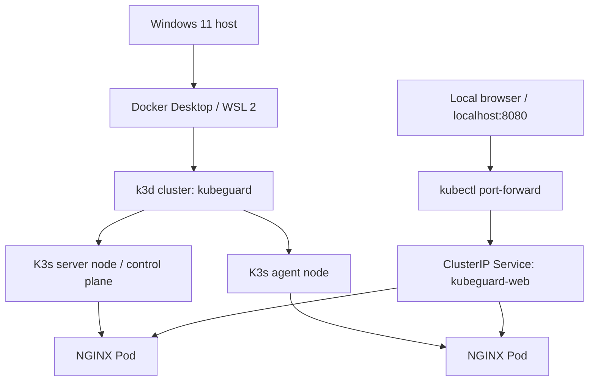

# KubeGuard — Kubernetes DevSecOps Platform

> A hands-on Kubernetes lab evolving into a secure, automated and observable DevSecOps platform.

**Project status:** Phase 1 completed — local Kubernetes cluster and sample workload validated. Security and CI/CD integrations described below are **planned**, not yet implemented.

## Overview

KubeGuard is a portfolio project focused on learning and demonstrating the operational practices required to deploy, manage, monitor and secure containerized applications in Kubernetes.

The project begins with a reproducible local K3s cluster managed through k3d and will evolve through infrastructure-as-code, automated delivery, GitOps, observability and runtime security.

## Current architecture



> This is a local learning environment, **not** a highly available production cluster. A single control-plane server remains a single point of failure. Kubernetes scheduling placed the two initial Pods on different nodes, but the current manifests do not enforce anti-affinity.

## Technology stack

| Area | Technology | Status |
| --- | --- | --- |
| Container runtime | Docker Desktop / WSL 2 | Implemented |
| Kubernetes distribution | K3s v1.35.5 via k3d v5.9.0 | Implemented |
| Cluster operations | kubectl | Implemented |
| Sample workload | NGINX (2 replicas) | Implemented |
| Kubernetes resources | Namespace, Deployment, ClusterIP Service, readiness probe, resource requests/limits | Implemented |
| CI/CD and image scanning | GitHub Actions, Trivy | Planned |
| GitOps and packaging | Argo CD, Helm | Planned |
| Kubernetes policy | RBAC, NetworkPolicy, Kyverno | Planned |
| Observability | Prometheus, Grafana | Planned |
| Runtime threat detection | Falco | Planned |

## Prerequisites

- Windows with Docker Desktop configured to run Linux containers (WSL 2 backend)
- `k3d` and `kubectl` installed and available in `PATH`
- A terminal with access to Docker Desktop

## Reproduce Phase 1

Clone this repository and run the following commands from its root directory. The cluster name `kubeguard` must be available; if it already exists, reuse it rather than creating a duplicate.

```powershell
k3d cluster create kubeguard --servers 1 --agents 1 --wait --timeout 180s
kubectl config use-context k3d-kubeguard
kubectl get nodes -o wide
kubectl create namespace kubeguard
kubectl apply -f k8s/base/web.yaml
kubectl rollout status deployment/kubeguard-web -n kubeguard --timeout=120s
kubectl get pods,deployments,services -n kubeguard -o wide
```

In a terminal, expose the internal Service to your local machine:

```powershell
kubectl port-forward -n kubeguard svc/kubeguard-web 8080:80
```

Open **http://localhost:8080** and confirm that the NGINX welcome page appears. The port-forward runs until you stop the command (Ctrl+C).

> If the namespace already exists, skip `kubectl create namespace kubeguard`.

## Phase 1 validation

- [x] Docker Desktop and WSL 2 verified
- [x] k3d and kubectl installed
- [x] Two-node K3s cluster created (one server, one agent)
- [x] Kubernetes system Pods verified healthy
- [x] `kubeguard` namespace created
- [x] Two NGINX replicas running and Deployment available
- [x] ClusterIP Service configured
- [x] Application accessed through `kubectl port-forward`
- [x] CLI evidence and browser screenshot captured

### Evidence

| Evidence | File |
| --- | --- |
| Cluster nodes | [`nodes.txt`](evidence/phase-01/nodes.txt) |
| System Pods | [`system-pods.txt`](evidence/phase-01/system-pods.txt) |
| Application resources | [`application.txt`](evidence/phase-01/application.txt) |


> Evidence captures represent a point-in-time validation of the lab, not ongoing production monitoring.

## Roadmap

- [x] **Phase 1 — Cluster foundation:** provision Kubernetes, deploy NGINX, capture evidence
- [ ] **Phase 2 — Custom application:** develop and containerize a small Python API; Kubernetes manifests and health endpoints
- [ ] **Phase 3 — CI pipeline:** automated tests, image builds, Trivy vulnerability scanning
- [ ] **Phase 4 — GitOps:** Helm charts and Argo CD deployment workflow
- [ ] **Phase 5 — Security controls:** least-privilege RBAC, NetworkPolicies, Kyverno policies
- [ ] **Phase 6 — Observability:** Prometheus metrics and Grafana dashboards
- [ ] **Phase 7 — Threat detection:** controlled Falco detections and documented investigation scenarios
- [ ] **Phase 8 — Portfolio release:** architecture documentation, threat model, demonstrations and lessons learned

## Repository structure

```text
KubeGuard/
├── k8s/
│   └── base/
│       └── web.yaml
├── evidence/
│   └── phase-01/
│       ├── nodes.txt
│       ├── system-pods.txt
│       ├── application.txt
│       └── nginx-localhost.png
└── README.md
```

## Security and scope notes

The current NGINX deployment is deliberately a **baseline lab workload**, not a production-hardened deployment. Hardening controls, non-root workload configuration, admission policies, network restrictions, authenticated delivery and image pinning will be introduced and verified in later phases.

Before publishing evidence, check the contents of screenshots and terminal captures to avoid exposing tokens, kubeconfig credentials or other sensitive information.

## Learning outcomes

- Kubernetes resource lifecycle, service discovery and scheduling
- Declarative deployments and repeatable validation
- DevSecOps tooling integration across build, deploy and runtime stages (upcoming)
- Clear technical evidence and architecture documentation
