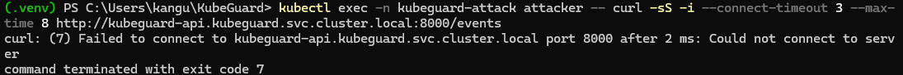
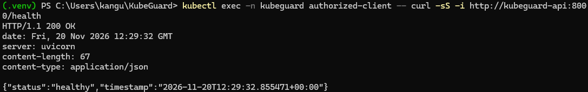

# Scenario 01 — Kubernetes Network Isolation

## Overview

This lab demonstrates how Kubernetes NetworkPolicies
can restrict unauthorized access to internal services
using namespace isolation and least-privilege rules.

The target is KubeGuard, a FastAPI security event
management application deployed in a local k3d cluster.

## Environment

- Kubernetes: k3d / K3s
- Application: KubeGuard FastAPI
- Target namespace: `kubeguard`
- Attacker namespace: `kubeguard-attack`
- Target service: `kubeguard-api`
- Target port: TCP/8000

## 1. Initial Security Assessment

An attacker-controlled Pod was deployed in a separate
namespace to test access to the internal API.

Command:

```bash
kubectl exec -n kubeguard-attack attacker -- \
  curl -i http://kubeguard-api.kubeguard.svc.cluster.local:8000/events
```

**Result:** HTTP 200 OK.

The attacker successfully retrieved four synthetic
security events without application authentication.

## 2. Namespace Isolation

An ingress NetworkPolicy was applied to restrict
connections to the FastAPI Pod.

The first policy allowed traffic from Pods within
the `kubeguard` namespace.

**Result:**
- External attacker: connection failed.
- Nginx Pod in the same namespace: HTTP 200 OK.

This demonstrated that namespace isolation alone
was insufficient for strict least-privilege access.

## 3. Least-Privilege NetworkPolicy

The NetworkPolicy was updated to permit traffic
only from Pods in the same namespace carrying:

`access: kubeguard-api`

The policy selects the FastAPI Pods and restricts
ingress traffic to TCP port 8000.

## 4. Final Security Validation

| Source | Expected Access | Observed Result |
|--------|-----------------|-----------------|
| External attacker Pod | Denied | Connection failed |
| Nginx Pod | Denied | Connection refused |
| Authorized client Pod | Allowed | HTTP 200 OK |
| FastAPI localhost | Allowed | Healthy |

The authorized client successfully accessed the API,
while both unauthorized test clients failed to connect.

## 5. Evidence

### Unauthorized Access Blocked



### Authorized Access Allowed



## 6. Security Considerations

NetworkPolicies provide network-level segmentation,
not application authentication.

Pod labels are not security credentials. Users who
can create or modify Pods may be able to assign
labels that match the policy.

Additional hardening should include:

- Kubernetes RBAC and controlled Pod creation.
- Admission policies to protect trusted labels.
- Application-level authentication and authorization.
- Monitoring and auditing of network access.

## Conclusion

This scenario demonstrates the transition from
unrestricted inter-namespace access to selective
network-level access control using Kubernetes
NetworkPolicies.

The final configuration allows authorized clients
while restricting unauthorized lateral connectivity.
